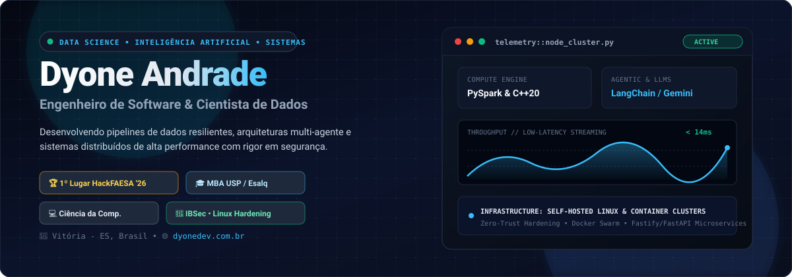

  <!-- Theme-Aware Animated SVG Hero Banner -->
  <picture>
    <source media="(prefers-color-scheme: dark)" srcset="assets/hero-dark.svg" />
    <source media="(prefers-color-scheme: light)" srcset="assets/hero-light.svg" />
    
  </picture>

   
   

  <!-- Primary Status & Quick Badges -->
  
  
  
  
  
  

    

  <!-- Quick Navigation Bar -->
  

    <a href="#-visão-geral">Visão Geral</a> •
    <a href="#-bento-grid--especialidades">Especialidades</a> •
    <a href="#-arquitetura-do-ecossistema-de-ia--dados">Arquitetura de Dados & IA</a> •
    <a href="#-stack-tecnológica">Stack Tecnológica</a> •
    <a href="#-trajetória-acadêmica--conquistas">Trajetória & Conquistas</a> •
    <a href="#-telemetria--github-stats">Estatísticas</a> •
    <a href="#-vamos-conversar">Contato</a>
  

---

### 👨‍💻 Visão Geral

Desenvolvedor Full Stack e Engenheiro de Software em aprofundamento contínuo e consolidação estratégica em **Data Science, Inteligência Artificial e Engenharia de Dados**. Atualmente graduando MBA em **Data Science, IA e Analytics (USP/Esalq)** e graduado em **Tecnologia em Análise e Desenvolvimento de Sistemas (TADS)**.

Minha atuação é pautada na convergência entre **software de altíssima performance** (Python, TypeScript e C++20), **modelagem analítica & pipelines distribuídos** (PySpark, Big Data, LangChain, LLMs) e **infraestrutura resiliente self-hosted** com rigor em **Linux Hardening e Cyber Security**.

> [!TIP]
> **Foco de Atuação:** Construção de ecossistemas orientados a dados em tempo real, orquestração de pipelines analíticos resilientes, integração de sistemas multi-agente autônomos e hardening de ambientes de produção.

---

### 🍱 Bento Grid // Especialidades

<table width="100%">
  <tr>
    <td width="50%" valign="top">
      <h4>🧠 Data Science, IA &amp; LLMs</h4>
      <ul>
        <li><b>Big Data &amp; Distributed Processing:</b> Pipelines distribuídos com PySpark, Pandas e NumPy.</li>
        <li><b>Arquiteturas Agênticas &amp; GenAI:</b> Orquestração de LLMs via LangChain, Gemini API e modelos locais via Ollama.</li>
        <li><b>Geospatial Analytics:</b> Processamento analítico geoespacial com GeoPandas.</li>
      </ul>
    </td>
    <td width="50%" valign="top">
      <h4>⚡ Engenharia de Software &amp; Core</h4>
      <ul>
        <li><b>Alta Performance:</b> Desenvolvimento de sistemas e algoritmos eficientes em C++20 e Python.</li>
        <li><b>APIs &amp; Microserviços:</b> Construção de endpoints assíncronos e escaláveis em FastAPI e Node.js.</li>
        <li><b>Modern Frontend:</b> Interfaces reativas e dados em tempo real com React e Next.js.</li>
      </ul>
    </td>
  </tr>
  <tr>
    <td width="50%" valign="top">
      <h4>🛡️ Cyber Security &amp; Linux Hardening</h4>
      <ul>
        <li><b>Certificação IBSec Essencial:</b> Princípios de defesa cibernética, testes de integridade e auditoria.</li>
        <li><b>Linux Hardening:</b> Configuração de servidores com foco em segurança em profundidade, iptables/UFW e isolamento.</li>
        <li><b>Infraestrutura Self-Hosted:</b> Deploy e gestão de containers Docker em homelab próprio.</li>
      </ul>
    </td>
    <td width="50%" valign="top">
      <h4>🏆 Hackathons &amp; Liderança Técnica</h4>
      <ul>
        <li><b>1º Lugar — HackFAESA 2026:</b> Campeão geral desenvolvendo a solução de alto impacto <i>NexoPit</i>.</li>
        <li><b>3º Lugar — HackFAESA 2024:</b> Destaque no desenvolvimento da plataforma <i>Taokay</i>.</li>
        <li><b>Resolução Sob Pressão:</b> Prototipação rápida da concepção à entrega funcional em maratonas de programação.</li>
      </ul>
    </td>
  </tr>
</table>

---

### 🧬 Arquitetura do Ecossistema de IA & Dados

O fluxo abaixo sintetiza o ciclo de vida dos dados e inferência implementado em minhas arquiteturas:

```mermaid
flowchart LR
    subgraph INGESTION[" Camada de Ingestão & Fontes "]
        direction TB
        S1["Streams de Sensores & Logs"]
        S2["APIs REST / Webhooks"]
        S3["Bancos Relacionais (SQL)"]
    end

    subgraph PROCESSING[" Motor de Processamento & Core "]
        direction TB
        E1["PySpark (Batch & Stream)"]
        E2["Python & GeoPandas"]
        E3["C++20 (Rotinas Críticas)"]
    end

    subgraph AI_LAYER[" Camada de Inteligência & LLMs "]
        direction TB
        A1["Orquestração de Agentes (LangChain)"]
        A2["Modelos Locais (Ollama)"]
        A3["Modelos Fundacionais (Gemini API)"]
    end

    subgraph DELIVERY[" Entrega, APIs & Visualização "]
        direction TB
        D1["FastAPI / Node.js Microservices"]
        D2["Next.js / Dashboards Analíticos"]
        D3["Linux Hardened / Docker Clustered"]
    end

    INGESTION --> PROCESSING
    PROCESSING --> AI_LAYER
    AI_LAYER --> DELIVERY
```

---

### 🛠️ Stack Tecnológica

#### Linguagens & Sistemas Core

  
  
  
  
  

#### Data Science, Inteligência Artificial & LLMs

  
  
  
  
  
  
  

#### Backend, Frontend, DevOps & Infraestrutura

  
  
  
  
  
  
  

---

### 🎓 Trajetória Acadêmica & Conquistas

<strong>📚 Formação Acadêmica &amp; Certificações Profissionais (clique para expandir)</strong>

 

| Nível / Programa | Instituição | Detalhes &amp; Foco |
|:---|:---|:---|
| **MBA em Data Science, IA &amp; Analytics** | **USP / Esalq** | Modelagem preditiva, Machine Learning avançado, Big Data e governança analítica. *(Graduando)* |
| **Tecnologia em Análise e Desenv. de Sistemas (TADS)** | *Graduado* | Engenharia de requisitos, modelagem relacional, arquitetura de software e desenvolvimento full stack. |
| **Certificação IBSec Essencial** | **IBSec** | Cyber Security, Linux Hardening, princípios defensivos, mitigação de vulnerabilidades e segurança operacional. |

<strong>🏆 Histórico em Hackathons &amp; Prêmios (clique para expandir)</strong>

 

- 🥇 **1º Lugar — HackFAESA 2026 (Projeto *NexoPit*)**:
  - Solução concebida e implementada de ponta a ponta sob regime de maratona, integrando automação inteligente, arquitetura resiliente e proposta de valor assertiva validada por banca avaliadora.
- 🥉 **3º Lugar — HackFAESA 2024 (Projeto *Taokay*)**:
  - Plataforma funcional focada em usabilidade e viabilidade técnica, combinando integração de serviços modernos e entregas em tempo recorde.

<strong>🖥️ Homelab, Infraestrutura Self-Hosted &amp; Hardening (clique para expandir)</strong>

 

- **Ambiente Self-Hosted:** Cluster de experimentação local com Linux dedicado para prototipagem de pipelines distribuídos, execução de instâncias locais de LLMs (Ollama) e testes de escalabilidade.
- **Segurança em Profundidade:** Políticas rigorosas de firewalling, isolamento em redes virtuais internas, monitoramento ativo de integridade e auditoria de logs.

---

### 📊 Telemetria // GitHub Stats

  <table border="0">
    <tr>
      <td>
        
      </td>
      <td>
        
      </td>
    </tr>
  </table>

   

  

---

  <h3>📫 Vamos Conversar?</h3>
  
Interessado em colaborar em soluções de IA, engenharia de dados ou sistemas de alta performance?

  

    
    
    
  

  

    
    
  

   
  <i>Construído com design system limpo, responsividade nativa e zero vazamento de dados.</i>

